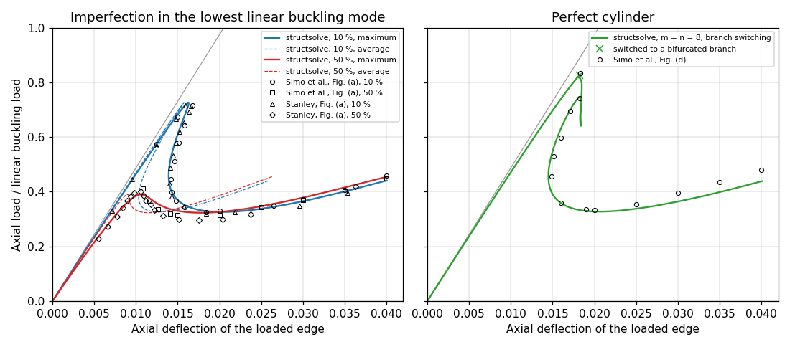

Post-buckling of an axially compressed cylinder
===============================================

The Riks method of structsolve traces the post-buckling path of a thin
cylinder under axial compression, deep into the post-buckled regime, for the
benchmark of Simo, Fox and Rifai (1990) [1]_, Section 6.3.4,
"Post-buckling analysis of a simply-supported cylinder; effect of initial
imperfections", pp. 54-57, Fig. 6.3.4 on p. 56, after Stanley (1985) [2]_:
radius `R = 36`, length `L = 100`, thickness `t = 0.125`, `E = 10^7`,
`\nu = 0.3`, in consistent units. The script is
``benchmarks/simo1990_cylinder.py``, which is not run by pytest; its
docstring tells how to run it.

The model
---------

As in [1]_ and [2]_, an `L/10 \times 15°` section is modelled, with
symmetry conditions on the interior edges and a simple support on the
loaded edge, such that the lowest buckling mode is the diamond mode of 5
axial half-waves and 12 circumferential waves: the section spans a quarter
of an axial wave and half a circumferential wave. It is a single
:class:`panels.shell.Shell` of `panels <https://github.com/saullocastro/panels>`_
0.15.0 with the Donnell kinematics, ``model = 'cylshell_clpt_donnell'``,
`a = L/10 = 10` along the axis `x` and `b = R \pi/12 = 9.42` along the arc
`y`, with the boundary conditions given by the flags of Bardell's functions
(``0`` removes the value, ``r`` its normal derivative):

=================  =====================================  ========================================
Edge               Condition                              Flags
=================  =====================================  ========================================
`x = 0`, loaded    simple support, `v = w = 0`            ``x1v = x1w = 0``, the others ``1``
`x = a`            symmetry, `u = v_{,x} = w_{,x} = 0`    ``x2u = x2vr = x2wr = 0``
`y = 0`, `y = b`   symmetry, `u_{,y} = v = w_{,y} = 0`    ``y1ur = y1v = y1wr = 0``, same for ``y2``
=================  =====================================  ========================================

The load is the axial force per unit length of the circumference
`N_{cl} = E t^2/(R \sqrt{3(1 - \nu^2)}) = 2626.9` applied at `x = 0` with
``add_distr_load_fixed_x``, scaled by the lowest load multiplier of the
linear buckling analysis, :func:`.lb`, such that the load factor is the load
normalized by the linear buckling load, as in [1]_. With `m = n` Bardell
terms along `x` and `y` the linear buckling load is `1.00472 N_{cl}` for
`m = n = 8` and `1.00415 N_{cl}` for `m = n = 10, 12, 14`. The linear
shortening of the loaded edge at the linear buckling load is 0.02095,
whereas the straight line of the linear prebuckling response in Fig. 6.3.4
reaches the load 1 at an axial deflection of 0.0205 (read from the
figure, `\pm 0.0002`): the abscissae of [1]_ are thus the shortening of the
`L/10` section at the loaded edge, the 2 % difference coming from the
normalizing buckling load or the prebuckling stiffness of the finite
elements of [1]_.

The initial imperfection
------------------------

Neither panels nor structsolve takes a geometric imperfection. For the
Donnell kinematics it is added exactly as follows. Let `w_0(x, y)` be the
imperfection, of Ritz vector `\boldsymbol{c}_0` (the `w` part of the lowest
linear buckling mode, `u = v = 0`, scaled to `\max |w_0| = \xi t`). The
membrane strains of the imperfect shell are

.. math::

    \varepsilon_{xx} = u_{,x} + \tfrac{1}{2} w_{,x}^2 + w_{0,x} w_{,x}, \quad
    \varepsilon_{yy} = v_{,y} + \frac{w}{R} + \tfrac{1}{2} w_{,y}^2 + w_{0,y} w_{,y}, \quad
    \gamma_{xy} = u_{,y} + v_{,x} + w_{,x} w_{,y} + w_{0,x} w_{,y} + w_{0,y} w_{,x}

and the curvatures are those of `w`, linear. Since the non-linear terms are
quadratic in `w`, these are exactly the differences of the strains of the
perfect shell, `\boldsymbol{\varepsilon}_{imp}(\boldsymbol{c}) =
\boldsymbol{\varepsilon}(\boldsymbol{c} + \boldsymbol{c}_0) -
\boldsymbol{\varepsilon}(\boldsymbol{c}_0)`, and the stress resultants are
`\boldsymbol{N}_{imp} = \boldsymbol{N}(\boldsymbol{c} + \boldsymbol{c}_0) -
\boldsymbol{N}_0`, `\boldsymbol{N}_0 = \boldsymbol{N}(\boldsymbol{c}_0)`, the
resultants of the linear and non-linear strains of the state
`\boldsymbol{c}_0`. With `\boldsymbol{B}(\boldsymbol{c}) = \partial
\boldsymbol{\varepsilon}/\partial \boldsymbol{c}`, affine in `\boldsymbol{c}`,
the internal force vector of the imperfect shell is

.. math::

    \boldsymbol{F}_{int,imp}(\boldsymbol{c}) = \int
    \boldsymbol{B}(\boldsymbol{c} + \boldsymbol{c}_0)^\top
    (\boldsymbol{N}(\boldsymbol{c} + \boldsymbol{c}_0) - \boldsymbol{N}_0) dA
    = \boldsymbol{F}_{int}(\boldsymbol{c} + \boldsymbol{c}_0) -
    \boldsymbol{F}_{int}(\boldsymbol{c}_0) - \boldsymbol{K}_G(\boldsymbol{N}_0)
    \boldsymbol{c}

because `\int (\boldsymbol{B}(\boldsymbol{c} + \boldsymbol{c}_0) -
\boldsymbol{B}(\boldsymbol{c}_0))^\top \boldsymbol{N}_0 dA =
\boldsymbol{K}_G(\boldsymbol{N}_0) \boldsymbol{c}`, with the geometric
stiffness matrix `\boldsymbol{K}_G(\boldsymbol{N}_0) = \int (N_{0xx}
\boldsymbol{g}_x^\top \boldsymbol{g}_x + N_{0xy} (\boldsymbol{g}_x^\top
\boldsymbol{g}_y + \boldsymbol{g}_y^\top \boldsymbol{g}_x) + N_{0yy}
\boldsymbol{g}_y^\top \boldsymbol{g}_y) dA`, `\boldsymbol{g}_x` and
`\boldsymbol{g}_y` the rows of the approximation of `w_{,x}` and `w_{,y}`.
The bending part follows the same formula, its strains being linear. The
tangent stiffness matrix is

.. math::

    \boldsymbol{K}_{T,imp}(\boldsymbol{c}) = \boldsymbol{K}_T(\boldsymbol{c} +
    \boldsymbol{c}_0) - \boldsymbol{K}_G(\boldsymbol{N}_0)

and `\boldsymbol{F}_{int,imp}(\boldsymbol{0}) = \boldsymbol{0}`: the imperfect
shell is unstressed at `\boldsymbol{c} = \boldsymbol{0}`, and its linear
stiffness matrix is `\boldsymbol{K}_{T,imp}(\boldsymbol{0})`. Panels'
:meth:`.Shell.calc_kG` with ``c = c0`` cannot be used for
`\boldsymbol{K}_G(\boldsymbol{N}_0)`: it has the resultants of the linear part
of the strains only (the geometric stiffness of the non-linear part is in
``calc_kC(c, NLgeom=True)``), such that it is homogeneous of degree one in
``c``. The script integrates `\boldsymbol{K}_G(\boldsymbol{N}_0)` at the
Gauss points of the shell, with `\boldsymbol{N}_0` from
:meth:`.Shell.stress` with ``NLgeom=True`` and the derivatives of Bardell's
functions of :mod:`panels.bardell`. The callables passed to
:class:`.Analysis` are:

.. literalinclude:: ../../benchmarks/simo1990_cylinder.py
    :pyobject: ImperfectShell

The command ``verify`` of the script checks, for `m = n = 8` and `\xi = 0.5`:

- the matrix of the script with the linear resultants equals
  ``calc_kG(c)`` of panels to `8 \times 10^{-16}`, whereas with the complete
  resultants the two differ by `2 \times 10^{-3}` (relative maximum entry,
  random state), i.e. ``calc_kG(c)`` has no non-linear resultants;
- `\boldsymbol{F}_{int,imp}(\boldsymbol{0}) = \boldsymbol{0}` exactly, and
  without imperfection the model is the perfect one exactly;
- the central differences of `\boldsymbol{F}_{int,imp}` along a random
  direction match `\boldsymbol{K}_{T,imp} \boldsymbol{v}` to `7 \times
  10^{-14}` (`h = 10^{-5}`), at a state with `\max|w| = 0.3 t`;
- independently of the formula above, the central differences of the strain
  energy `\tfrac{1}{2}\int \boldsymbol{\varepsilon}_{imp}^\top
  \boldsymbol{ABD}\, \boldsymbol{\varepsilon}_{imp} dA`, integrated from
  :meth:`.Shell.strain` of `\boldsymbol{c} + \boldsymbol{c}_0` and
  `\boldsymbol{c}_0`, match `\boldsymbol{F}_{int,imp}(\boldsymbol{c})^\top
  \boldsymbol{v}` to `1.7 \times 10^{-8}` and `1.7 \times 10^{-10}` for `h =
  10^{-4}` and `10^{-5}` (second order), whereas with ``calc_kG(c0)`` in
  place of `\boldsymbol{K}_G(\boldsymbol{N}_0)` the difference is `7.5 \times
  10^{-5}`.

The analyses
------------

``NL_method = 'arc_length_riks'`` with ``final_load_factor = None``,
``initialInc = maxInc = 0.1`` and the stop criterion
:func:`.stopping.value_reached` of the maximum axial deflection 0.04, all
other attributes at their default values, e.g. Crisfield's convergence
criterion with ``relTOL = 1e-9``. The residual of every converged increment
is below `10^{-9}` of the reference load. The maximum and the average axial
deflections are those of `u(0, y)` over 61 points along the loaded edge.

The perfect cylinder runs with ``inertia = True`` and ``branch_switching =
10``, ``initialInc = maxInc = 0.03``, ``linear_solver = 'splu'`` and the
unknowns scaled to a unit diagonal of the linear stiffness matrix (the class
``ScaledModel`` of the script, which changes only the coordinates of the
Ritz vector). Without the scaling the critical eigenvector of
:func:`.arc_length._critical_eigenvector` is not that of the bifurcation:
its subspace of ``num_neg + 2`` vectors has the eigenvalues closest to zero
in the Euclidean norm, those of weakly stiff in-plane Ritz terms, constant
along the path (`1.5 \times 10^{-4}` and `1.8 \times 10^{-4}` with the
scaling), and the switch converges back on the fundamental path. With
``linear_solver = 'pardiso'`` the count of negative eigenvalues, with 18 to
20 perturbed pivots, is late: the tangent stiffness matrix has a negative
eigenvalue from the load factor 0.83 on (dense eigenvalues), PARDISO counts
it from 0.90 on, where the eigenvalue is no longer close to zero.

Results
-------

The values read from Fig. 6.3.4 of [1]_ (`\pm 0.0003` in the axial
deflection and `\pm 0.01` in the load, see the script for all the points)
against structsolve, with `m = n = 12` unless stated; `u_{max}` and
`u_{avg}` are the maximum and the average axial deflection of the loaded
edge, the first limit load is the first maximum of the load, the minimum
load is the minimum after it, and `P(0.04)` the load at `u_{max} = 0.04`:

============================================  ======================  ==================  ===================
Quantity                                      Simo et al. [1]_, read  Stanley [2]_, read  structsolve
============================================  ======================  ==================  ===================
10 %: first limit load                        0.715                   0.717               0.727
10 %: `u_{max}` at the limit load             0.0168                  0.0159 to 0.0166    0.0163
10 %: smallest `u_{max}` of the snap-back     0.0142                  0.0140              0.0139
10 %: minimum load                            0.326 at 0.018          0.319 at 0.018      0.326 at 0.0203
10 %: load at `u_{max}` = 0.025, 0.03, 0.035  0.344, 0.372, 0.406     0.395 at 0.0353     0.338, 0.365, 0.401
50 %: first limit load                        0.411                   0.402               0.390
50 %: `u_{max}` at the limit load             0.0108                  0.0106              0.0107
50 %: minimum load                            0.315 at 0.015-0.020    0.297 at 0.0175     0.323 at 0.0177
50 %: load at `u_{max}` = 0.025, 0.03, 0.035  0.344, 0.370, 0.401     0.420 at 0.0363     0.347, 0.379, 0.42
10 % and 50 %: load at `u_{max}` = 0.04       0.459 and 0.449         -                   0.441 and 0.455
perfect: first bifurcation load               0.833                   -                   0.827 (m = n = 8)
perfect: `u_{max}` at the bifurcation         0.0183                  -                   0.0182
perfect: smallest `u_{max}` after it          0.0149 at 0.457         -                   0.0145 at 0.453
perfect: minimum load                         0.333 at 0.020          -                   0.327 at 0.0208
perfect: load at `u_{max}` = 0.03, 0.04       0.397, 0.480            -                   0.364, 0.438
============================================  ======================  ==================  ===================

At `u_{max}` = 0.04 the two curves of Fig. 6.3.4 (a) are 0.01 apart, after
crossing each other, such that which one is the 10 % imperfection is not
certain from the figure.

The Ritz approximation is converged: from `m = n = 10` on, the limit loads,
the minimum loads and the loads at `u_{max} = 0.04` do not change in the
third digit, see the table below and the dotted curves of `m = n = 8, 10,
14` in the figure, which are on the curves of `m = n = 12`:

=======  =====  ========================  ===================  ==========================  =============================  =========  ====================
Case     m = n  Buckling load / `N_{cl}`  First limit load     `u_{max}`, `u_{avg}` at it  Minimum load, `u_{max}` at it  `P(0.04)`  Increments, time (s)
=======  =====  ========================  ===================  ==========================  =============================  =========  ====================
10 %     8      1.00472                   0.7276               0.01630, 0.01576            0.3268, 0.0201                 0.4420     260, 49
10 %     10     1.00416                   0.7267               0.01630, 0.01574            0.3261, 0.0203                 0.4412     278, 215
10 %     12     1.00415                   0.7267               0.01630, 0.01574            0.3260, 0.0203                 0.4411     281, 580
10 %     14     1.00415                   0.7267               0.01630, 0.01574            0.3260, 0.0203                 0.4411     282, 1420
50 %     8      1.00472                   0.3928               0.01072, 0.00904            0.3228, 0.0173                 0.4552     85, 21
50 %     10     1.00416                   0.3905               0.01071, 0.00901            0.3234, 0.0178                 0.4547     90, 87
50 %     12     1.00415                   0.3902               0.01069, 0.00900            0.3234, 0.0177                 0.4546     91, 255
50 %     14     1.00415                   0.3902               0.01069, 0.00900            0.3234, 0.0177                 0.4545     91, 568
perfect  8      1.00472                   0.8273               0.01821, 0.01821            0.3273, 0.0208                 0.4383     174, 51
perfect  12     1.00415                   none, 0.980 at 0.04  -                           -                              -          79, 223
=======  =====  ========================  ===================  ==========================  =============================  =========  ====================

The times are those of one process (``MKL_NUM_THREADS=1``) on a laptop
shared with other jobs, mostly spent in the internal forces and tangent
stiffness matrices of panels.

The computed curves agree with those of [1]_ and the points of Stanley
[2]_ on the whole path: the limit loads differ from those of [1]_ by
+0.012 (10 %) and -0.021 (50 %) of the buckling load, and from those of
[2]_ by +0.010 and -0.012; the deflections at the limit loads agree within
0.0005, the snap-back of the 10 % imperfection, back to `u_{max} = 0.0139`
(0.0142 read in [1]_), and the post-buckling plateau at 0.32 to 0.33 are
reproduced, and from `u_{max} = 0.025` to 0.04 the loads are within 0.02
of [1]_. Fig. 6.3.4 (a) plots the maximum
axial deflection; Fig. 6.3.4 (c) of [1]_ shows how much smaller the average
deflection is in the post-buckled regime, as do the dashed curves.

The perfect cylinder
--------------------

With `m = n = 8` the sign of the determinant changes at the load factor
0.827, the bifurcation is switched to along the critical eigenvector, and
the bifurcated branch is traced down to the post-buckling plateau and up to
`u_{max} = 0.04` in 174 increments (51 s): the bifurcation load and
deflection and the snap-back of the curve, to `u_{max} = 0.0145` at the
load 0.453, are those of Fig. 6.3.4 (d) within the reading precision, the
minimum load is 0.006 below, and the loads beyond `u_{max} = 0.025` are
0.02 to 0.04 below those of [1]_, whose curve, the envelope of the paths
of several branch switches as they say, ends above those of the
imperfect cylinders, whereas the computed one, of a single switch, ends
just below them. The bifurcation load 0.827 is 18 % below the linear
buckling load, because of the non-linear axisymmetric prebuckling of the
radially restrained loaded edge: the tangent stiffness matrix of the
fundamental path has its first negative eigenvalue between the load
factors 0.817 and 0.834 (dense eigenvalues, `m = n = 8`; the same for
`m = n = 12`).

With `m = n = 10` and `12` the switch fails: the weakly stiff in-plane Ritz
terms mentioned above have scaled eigenvalues of `1.8 \times 10^{-5}` and
`3.3 \times 10^{-6}`, closer to zero than the negative eigenvalue of the
first step beyond the bifurcation, such that the critical eigenvector is
again one of them; with `m = n = 10` the switch is abandoned, with `m = n =
12` the sign of the determinant of SuperLU does not even change, and the
path stays on the fundamental branch up to the load 0.980 at `u_{max} =
0.04` with one negative eigenvalue. Tracing the perfect cylinder with
`m = n \ge 10` would need a critical eigenvector that looks for the
negative eigenvalues rather than for the eigenvalues closest to zero, or a
correct count of PARDISO.

References
----------

.. [1] Simo, J.C., Fox, D.D., Rifai, M.S., On a stress resultant
   geometrically exact shell model. Part III: Computational aspects of the
   nonlinear theory, Computer Methods in Applied Mechanics and Engineering,
   79(1), 21-70, 1990. https://doi.org/10.1016/0045-7825(90)90094-3
.. [2] Stanley, G.M., Continuum-based shell elements, PhD dissertation,
   Applied Mechanics Division, Stanford University, 1985.
